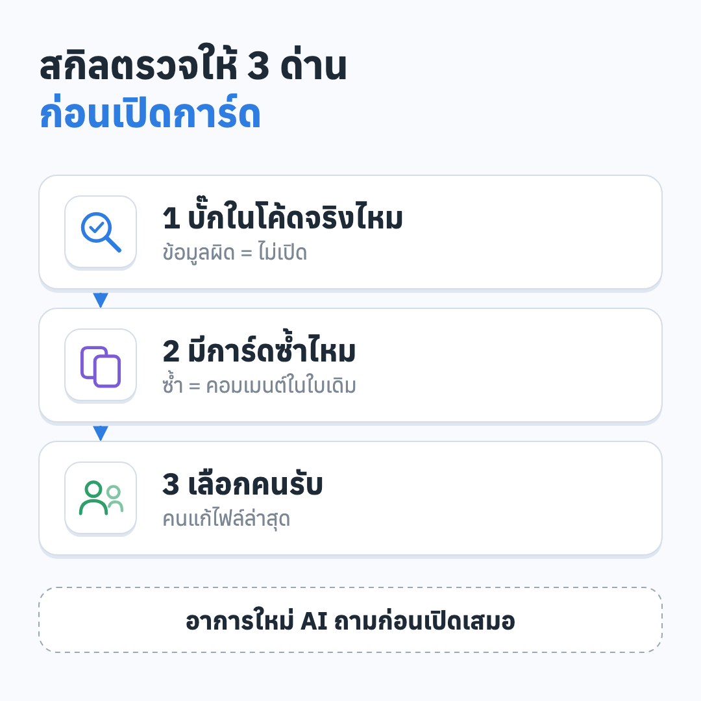
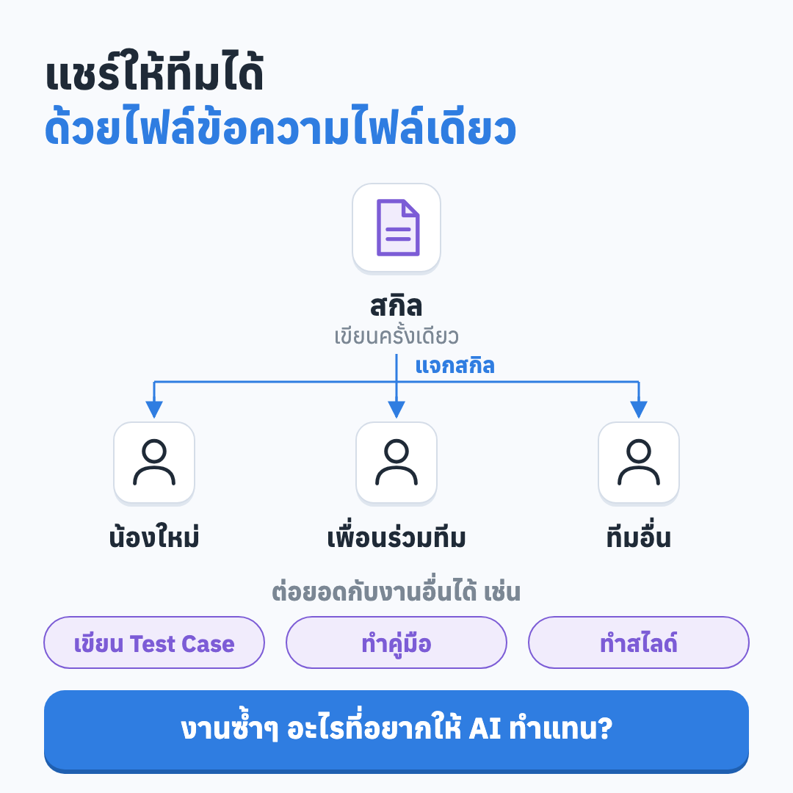

# skills

ตัวอย่าง "สกิล" (Skill) สำหรับ AI ผู้ช่วยเขียนโค้ดอย่าง Claude Code ที่ใช้จริงในงาน QA ตัดข้อมูลเฉพาะองค์กรออกแล้ว

สกิลคือไฟล์ข้อความธรรมดาที่อธิบายขั้นตอนงานหนึ่งอย่างให้ AI ทำตามได้เหมือนเดิมทุกครั้ง เขียนครั้งเดียว แชร์ให้ทีมได้ด้วยการส่งไฟล์


## สกิลในนี้

| สกิล | ทำอะไร |
|---|---|
| [open-issue](skills/open-issue/SKILL.md) | ส่งรูปกับบอกอาการในแชท AI ตรวจว่าเป็นบั๊กจริง เช็กการ์ดซ้ำ หาคนรับ แนบรูป เปิด ISSUE ใน GitLab แล้วส่งลิงก์กลับ |
| [dev-handoff](skills/dev-handoff/SKILL.md) | สำหรับ Dev: ก่อนส่งงานให้ QA ดึงข้อมูลจาก git ถาม 4 ข้อ แล้วร่างคอมเมนต์ "แก้อะไร ยังไม่ทำอะไร เทสด้วย user ไหน เช็กเองแล้วอะไรบ้าง" ให้แปะในการ์ด |
| [mmd2drawio](skills/mmd2drawio/README.md) | แปลง Mermaid เป็นไดอะแกรม HTML/SVG สไตล์การ์ดโค้งมนในคำสั่งเดียว (Node.js มีชุดทดสอบ 83 ข้อ) มีต้นแบบภาพโพสต์แบบการ์ดไอคอน |
| [delegate](skills/delegate/SKILL.md) | ตัดสินว่างานไหนส่งให้ subagent รุ่นถูกกว่า (Haiku / Sonnet) พร้อมวิธีเขียนคำสั่ง ตรวจผล และจดบันทึก มี agent สำเร็จรูป 3 ตัว: `test-runner`, `big-file-reader`, `code-scanner` |



## วิธีใช้

ตัวอย่างนี้ใช้ `open-issue` สกิลอื่นใช้วิธีเดียวกัน

1. คัดลอกโฟลเดอร์ `skills/open-issue` ไปไว้ที่ `~/.claude/skills/` (ใช้กับทั้งเครื่อง) หรือ `.claude/skills/` ในโปรเจกต์ (ใช้กับโปรเจกต์นั้น)
2. ตั้งตัวแปร `GITLAB_URL` และ `GITLAB_TOKEN` (Token สิทธิ์ `api` ห้ามใส่ลงในไฟล์หรือ commit)
3. แก้ label และรายชื่อคนที่ assign ได้ให้ตรงกับทีมคุณ
4. บอก AI ว่า "เปิดการ์ด" แล้วส่งรูปกับอาการ

## สร้างสกิลของตัวเอง

1. ทำงานนั้นกับ AI ในแชทจนได้ผลที่ถูกใจ
2. บอกว่า "ช่วยสร้างสกิลสำหรับแชร์ในทีมจากที่เราทำเมื่อกี้"
3. อ่านไฟล์ที่ได้ แก้ส่วนที่ไม่ตรง แล้วทดลองใช้อีกรอบ



## โครงสร้าง

```
skills/
  open-issue/SKILL.md
  dev-handoff/SKILL.md
  delegate/
    SKILL.md
    agents/        # test-runner, big-file-reader, code-scanner
  mmd2drawio/      # ตัวแปลง Mermaid (มีโค้ด Node.js)
assets/            # ภาพประกอบ
```

แต่ละสกิลคือโฟลเดอร์ที่มีไฟล์ `SKILL.md` เป็นหลัก (ส่วนหัวบอกชื่อกับคำอธิบายให้ AI รู้ว่าเมื่อไรควรใช้) ไฟล์อื่นในโฟลเดอร์เป็นข้อมูลหรือสคริปต์เสริม

## ข้อควรระวัง

- อย่าใส่รหัสผ่าน Token หรือชื่อลูกค้าลงในไฟล์สกิล
- ให้ AI ถามก่อนเปิดเมื่อเป็นอาการใหม่ ลองรอบแรกกับ project ทดสอบก่อน

## หมายเหตุ

สกิลทั้งหมดเขียนเป็นภาษาไทยและตัดชื่อลูกค้า ชื่อระบบ ที่อยู่เซิร์ฟเวอร์ และรายชื่อคนในทีมออกแล้ว นำไปแก้ให้เข้ากับงานของคุณได้เลย
